# Website

De webapp is een Next.js-app (App Router) in `src/app/`. Ze is in alfa. Versie 1 van SR-112 (ontwerp: `.agent/plans/2026-10-12-sr-112-v1-design.md`) bevat de shell, het mailingoverzicht, Instellingen en de flow per mailing tot en met de formaatvalidatie en de exports. Mailings staan voorlopig in IndexedDB in de browser; later op een gedeelde drive van de tenant (ADR 0007).

## Pagina's

| Pad | Bestand | Wat |
|---|---|---|
| `/` | `src/app/page.tsx` | Landingspagina: enkel "Aanmelden met Google"; aangemeld door naar `/mailings` |
| `/mailings` | `src/app/(app)/mailings/page.tsx` | Overzicht: zoeken, sorteren, weergave, archiveren |
| `/mailings/nieuw` | `src/app/(app)/mailings/nieuw/page.tsx` | Stap 1 van een nieuwe mailing (`ImportStep`) |
| `/mailings/[code]` | `src/app/(app)/mailings/[code]/page.tsx` | De flow van een mailing (`MailingPage`, `MailingFlow`); `?stap=gegevens` opent stap 1 om de gegevens aan te passen |
| `/archief` | `src/app/(app)/archief/page.tsx` | Gearchiveerde mailings |
| `/deposits` | `src/app/(app)/deposits/page.tsx` | Landingspagina "Dit onderdeel bouwen we nog" |
| `/instellingen` | `src/app/(app)/instellingen/page.tsx` | Organisatie, bpost-gegevens, standaardwaarden; Google Drive als plaatshouder. Vervangt het dashboard |
| `/install` | `src/app/install/page.tsx` | Installatie-instructies voor de AI-assistent |
| `/reference` | `src/app/reference/page.tsx` | Statische transparantiepagina met tool- en instructieteksten (`src/generated/tool-registry.json`) |

Alles onder `src/app/(app)/` zit achter de login (`layout.tsx`): zonder sessie of tenant gaat de gebruiker naar `/`. De layout zet de shell (`src/components/app-shell/`) en één `MailingStoreProvider` per tabblad.

## Code

- `src/components/app-shell/`: `AppShell` (zijbalk, inklappen, paneel onder 1024 px), `Sidebar`, `UserMenu` (donkere modus, afmelden), `Placeholder` ("binnenkort"), `useStoredPreference` (`localStorage`, voorvoegsel `bpost-e-masspost:`), `tokens.css` (kleuren, licht en donker op `.app`) en `app.module.css` (vertaald uit `docs/ontwerp/webapp/app-shell.html`).
- `src/components/mailings/`: de lijst, de rij, het menu "…", het statusicoon en `MailingStoreProvider` (`IndexedDbMailingStore`).
- `src/components/mailing-flow/`: de flow, met als basis de vroegere POC: `ImportStep` en `FileDrop` (stap 1), `MappingStep`, `FormatStep`, `MetaPills`, `StepBar`, `MailingFlow`, `MailingPage`, `useMailingSaver` (bewaren in volgorde, revisiecontrole, 2 s na de laatste correctie) en `resume.ts` (verste geldige stap).
- `src/components/settings/SettingsForms.tsx` met de server actions in `src/app/(app)/instellingen/actions.ts`.
- **Opslag:** `src/core/masspost/store/` (library): het Zod-schema van `mailing.json`, `MailingStore` met `MemoryMailingStore` en `IndexedDbMailingStore` (één database per tenant, `bpost-e-masspost:<tenantId>`, stores `mailings` en `files`). Elke schrijfactie verhoogt `revision`; een oudere revisie geeft `RevisionConflictError`.
- **Standaardwaarden** staan in `tenant_preferences` (`default_format`, `default_priority`, `default_gen_mid`, `default_presort`, `code_prefix`, migratie `drizzle/0005_tenant_preferences_defaults.sql`). Geen adressen in de database.

## Flow van een mailing

Gebouwd op de schets `docs/ontwerp/webapp/formaatvalidatie.html` (besluiten 22 tot 42 in `.agent/plans/2026-10-02-masspost-web-flow-design.md`) en `app-shell.html` (SR-112).

- **Inlezen:** `parseExcelAddresses` (SheetJS, ADR 0005) op de main thread, geladen met een dynamische `import()`. Leest .xlsx, .xlsm, .xls en .ods (`ADDRESS_FILE_EXTENSIONS` in `src/core/masspost/address-file.ts`). Normale grens 25.000 adressen; tot 150.000 met een waarschuwing (besluit 43). Hervatten leest de Excel opnieuw in uit de store.
- **Regels:** `format-check.ts` (`checkFieldValue`, `proposeFieldValue`, `findFormatIssues`, `missingTargets`). Dezelfde functies controleren live tijdens het aanpassen. De klantenpagina met de regels staat in de groep Documentatie (Webapp, Formaatvalidatie); een test houdt ze gelijk met `CHARACTER_REPLACEMENTS` en `ABBREVIATIONS`.
- **Clientcode** importeert de modules rechtstreeks (`excel`, `mapping`, `suggest-mapping`, `format-check`, `mask`, `store/…`), nooit `src/core/masspost/index.ts`: die trekt FTP en Node-code mee.
- **Stijl:** CSS-modules met de tokens uit `tokens.css`, licht en donker. Geen Tailwind of shadcn.
- **Bekende indeling:** `suggestColumnMapping` meldt `preset: 'aft'` voor de Address File Tool. Een vaste export van Contrapunt bestaat niet (besluit 50). Zijn de adreskolommen gevuld, dan slaat de flow het koppelen over; zonder formaatfouten gaat hij meteen naar stap 4.
- **Pills** (besluit 46): `MetaPills.tsx`, een icoon met een getal en de uitleg als tooltip en als tekst voor schermlezers.
- **Koppelen:** de rol Land (Comp 17/18, enkel buiten België), een profiel per kolom bij een klik, een sjabloon-envelop met de volgorde per vak (`columnOrder`), en voorbeeldenveloppen per soort adres (`addressKinds`, eerste 20.000 rijen).
- **AI-voorstel** (ADR 0006, besluit 13 van het AI-plan): een schakelaar (`role="switch"`) in de kop van "Gebruiken als".
  - De pagina geeft `aiModel` door als `MASSPOST_SUGGEST_MAPPING_MODEL` een geldig `provider/model` is. Zonder model is er geen schakelaar.
  - `ai-suggestion.ts` bouwt de body (`columnExamples`, `columnFillCounts`, `maskExamples`) en roept de route op. `rolesFromSuggestion` (`columns.ts`) zet het antwoord om in rollen en `columnOrder`.
  - `MailingFlow` onthoudt het voorstel: aan, uit en weer aan vraagt het model niet opnieuw. Uit zet de keuze van vóór het aanzetten terug.
  - `✦` vóór de tekst van de keuze van de AI ("✦ Naam"), zodra er een voorstel is (ook bij uit). Is het de huidige keuze, dan krijgt de keuzelijst "Voorstel van AI" voor schermlezers (`aria-describedby`).
  - Bij een fout springt de schakelaar terug naar uit, met een melding.
- **Stap 4:** "Opslaan voor bpost (AFT, .xls)" via `buildAftExport` (besluit 57), met de verbeteringen en zonder uitgesloten rijen. "Opslaan voor de drukker" via `buildPrinterExport` (besluiten 48 en 49): het oorspronkelijke eerste werkblad met de kolommen *Meesturen* en *Volgnummer bpost*. De `seq` is het rijnummer (`findFormatIssues` en `mapRows` met `rowNumbers`).
- **Link naar de regels:** `NEXT_PUBLIC_DOCS_URL` (de GitBook-site). Zonder die variabele verdwijnt de link.

**Testlijsten.** `npm run generate:large-xlsx -- --rows 35000 --out tmp/adressen-35000.xlsx` maakt een verzonnen lijst in de indeling van Contrapunt, met ±3 % bewuste formaatfouten. Eindigt `--out` op `.xls`, dan schrijft het Excel 97-2003 (maximaal 65.535 rijen).

## Aanmelden

Auth.js (NextAuth v5) met één provider, Google (`src/lib/auth.ts`).
- Het sessiebeheer gaat via de Drizzle-adapter naar Neon Postgres.
- Bij de eerste aanmelding (`createUser`) wordt een tenant aangemaakt en aan de gebruiker gekoppeld. Heeft een bestaande gebruiker er nog geen, dan gebeurt dat bij `signIn`.
- Routes: `/api/auth/*` (extern beheerd door Auth.js, niet in de OpenAPI-spec).
- Zonder sessie stuurt alles onder `src/app/(app)/` door naar `/`. De MCP-login (`/oauth/authorize`) stuurt een gebruiker zonder bpost-gegevens ook naar `/`.

## Lokaal draaien

```bash
npm ci
cp .env.example .env.local   # waarden invullen, zie Hosting en omgevingsvariabelen
npm run dev
```

Instellingen bewaart het bpost-wachtwoord versleuteld (AES-256-GCM, `ENCRYPTION_KEY`).

## Geplande flow voor mailings (ontwerp)

Ontwerp van 2 oktober 2026, nog niet gebouwd. De library en de API komen eerst, deze schermen daarna. Het ontwerp gaat uit van het Centraal model: de adressen staan in onze database. Die keuze is nog open, zie [Architectuurmodellen](architectuurmodellen.md).

Een mailing doorloopt vijf stappen. Elke stap heeft een eigen icoon, dat de gebruiker ook in het overzicht ziet. De kleur van een vak toont wie aan zet is.


1. **Importeren** (vroeger "Opladen"): een .xlsx-bestand, normaal tot 25.000 adressen (op termijn meer, besluit 43). De server leest het in het geheugen in en zet alle kolommen in de database. Het bestand zelf wordt niet bewaard.
2. **Koppelen:** elke kolom krijgt een rol: adres, context (bewaren en tonen bij het corrigeren) of niet bewaren. De indeling van de Address File Tool (AFT) wordt herkend.
3. **Formaatvalidatie:** de rijen worden nagekeken op de regels van bpost: tekens, lengte van de velden, verplichte velden en gekoppelde kolommen. Per formaatfout komt een voorstel dat de gebruiker bevestigt of aanpast. Zonder formaatfouten gaat de mailing vanzelf verder. Op het scherm staat onder de titel: "Voldoet je lijst aan de regels van bpost? We kijken de tekens, de lengte van elk veld, de verplichte velden en de gekoppelde kolommen na."
4. **Adrescontrole:** een `MailingCheck` bij bpost. Onder 96 % is een nieuwe controle verplicht, tussen 96 en 98 % volgt een waarschuwing.
5. **Indienen:** een `MailingCreate`. Daarna ligt alles vast; wijzigen kan enkel door in te trekken en opnieuw in te dienen.

Na de deposit, die buiten de app in het bpost-portaal gebeurt, markeert een gebruiker de mailing als afgegeven. 30 dagen later worden de adressen gewist. Het logboek blijft bewaard.



Een toestand wisselt enkel na een bevestigd feit, zoals een geslaagde upload of een antwoord van bpost. Mislukt iets aan onze kant, dan blijft de toestand staan en verschijnt er een foutmelding. Weigert bpost de indiening (Status 998 of 999), dan gaat de mailing terug naar Gecontroleerd. Voor de gebruiker vallen de toestanden samen tot drie statussen: wachten, actie nodig en klaar.
